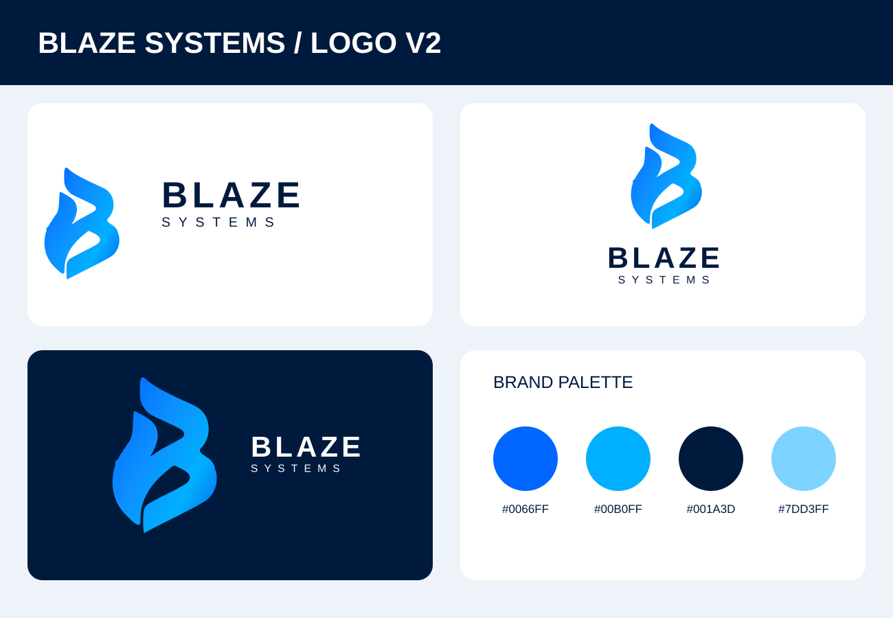

# Logo V2 — Blaze Systems Branding Package

**Brand:** Blaze Systems / BlazingSystems  
**Title:** Logo V2  
**Approved reference:** user-supplied blue Blaze Systems branding board (20 October 2026)

This branding package uses the same stylized flame-shaped **B** and **BLAZE / SYSTEMS** wordmark shown in the owner-approved reference. It includes editable traced SVG vectors, blue/dark/monochrome logo layouts, an app icon, three SVG mockups, brand guidelines, and a responsive single-file HTML application demo.

**Browse:** [Style guide](docs/BRAND_GUIDELINES.md) · [Brand preview](preview/Logo-V2-overview.svg) · [Live-use HTML sample](samples/index.html) · [Source icon](assets/vector/icon-traced.svg).

## Included
- `assets/vector/`: icon, horizontal, dark, stacked, black/white and app icon (editable SVG).
- `mockups/`: concept business card, store signage and mobile splash (SVG).
- `samples/`: standalone branded app UI and reusable design tokens.
- `docs/`: detailed palettes, typography, layouts, restrictions and provenance.
- `scripts/build.py`: generates raster PNG sizes, a PDF guide and a ZIP for distribution.
- `.github/workflows/logo-v2-brand-kit.yml` (repo root): builds downloadable kit as a GitHub Actions artifact.

### Important: fidelity and original artwork
The user supplied a **flattened image presentation**, not an illustrator/PSD master. SVG curves, gradients and text above are **reconstructed approximations**, not an exact original vector master. The original board is retained in the user-provided downloadable ZIP supplied in the ChatGPT conversation; that source PNG is **not uploaded to this repository**. No PSD/AI/EPS original is claimed. The placeholder GitHub URL and QR code inside the original presentation are not official links.

Generate all PNG, PDF and ZIP files locally: `python -m pip install cairosvg reportlab && python branding/Logo-V2/scripts/build.py` from the repository root. The workflow also uploads a generated kit archive when triggered.

**Status:** Digital-use sample kit; final print/master fidelity and artwork rights need review.
